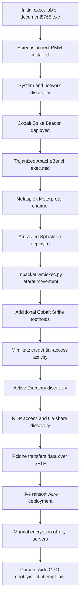
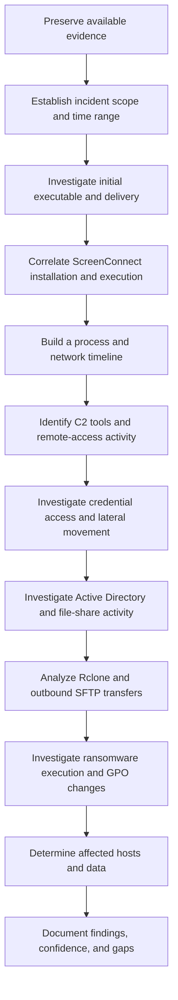

# DFIR Daily Learning — Day 2

## Case Study: From ScreenConnect to Hive Ransomware in 61 Hours

**Source:** The DFIR Report  
**Original Report:** https://thedfirreport.com/2023/09/25/from-screenconnect-to-hive-ransomware-in-61-hours/  
**Incident Period:** October 2022  
**Report Published:** September 25, 2023  
**Focus Areas:** Initial Access, RMM Abuse, Cobalt Strike, Metasploit, Meterpreter, Credential Access, Lateral Movement, Data Exfiltration, Hive Ransomware

---

## 1. Objective

The objective of this exercise was to understand how an attacker used legitimate remote-management software and multiple post-exploitation tools to compromise a Windows environment, move between systems, access credentials, exfiltrate data, and deploy ransomware.

This report-based case study focuses on reconstructing the attack chain, identifying potential forensic evidence, and understanding how defenders can detect similar activity.

This is a study of a published incident, not an independent forensic investigation.

## 2. Incident Summary

The intrusion began with the execution of an executable named `document8765.exe`. According to information cited by the report, the file was likely delivered through an email link.

Execution of the file led to the installation of ScreenConnect, a legitimate Remote Monitoring and Management (RMM) tool.

The attacker subsequently used Windows discovery utilities, Cobalt Strike, a trojanized ApacheBench executable containing Metasploit shellcode, Meterpreter, additional RMM software, Impacket's `wmiexec.py`, and Mimikatz.

During the intrusion, the attacker established additional remote-access channels, gathered information about the domain, accessed file shares and backup infrastructure, and transferred data to a remote server using Rclone over SFTP.

Finally, the attacker deployed Hive ransomware. Manual execution encrypted several key servers, while an attempted domain-wide deployment through Group Policy failed because of incorrect settings.

The reported time from initial access to ransomware was 61 hours.

## 3. Full Attack Workflow

**Workflow note:** This diagram summarizes the major stages, not every event in exact chronological order. The report records activity across approximately 61 hours, with periods of inactivity between stages.

## 4. Detailed Attack Timeline

### Stage 1 — Initial Access

The intrusion started with `document8765.exe`, an executable masquerading as a legitimate document.

The report cites Huntress research indicating that the file was likely delivered through an email link. Telemetry showed the URL being accessed by an Outlook process.

**Key lesson:** A filename resembling a document does not prove that a file is a document. File type, origin, hash, execution history, and parent process should be examined.

### Stage 2 — ScreenConnect Installation

Execution of the initial file staged and executed a Windows Installer package, resulting in the installation of ScreenConnect.

ScreenConnect is legitimate remote-support software, but unauthorized installation can give an attacker persistent remote access.

The report notes that the initial installation required local administrator privileges; a less-privileged user would cause the installation to fail.

ScreenConnect allowed the attacker to execute commands through its remote-management functionality.

**Key lesson:** Legitimate administrative software can become a foothold for an attacker when installed or controlled without authorization.

### Stage 3 — System and Network Discovery

The attacker used built-in Windows utilities, including:

- `systeminfo` — obtains system and operating-system information.
- `ipconfig` — displays IP configuration.
- `net` — provides information and administrative functions relating to users, groups, and network resources.
- `nltest` — can query Windows domain and trust information.

These commands helped the attacker understand the host and the surrounding domain environment.

**Key lesson:** These commands are not inherently malicious. Their execution context, frequency, parent process, user account, and relationship to other suspicious events determine whether they are concerning.

### Stage 4 — Cobalt Strike Deployment

The attacker deployed a Cobalt Strike Beacon through a PowerShell stager that used Background Intelligent Transfer Service (BITS) to retrieve the payload.

Cobalt Strike is a legitimate commercial adversary-simulation platform. Its Beacon component supports command-and-control and post-exploitation operations. Attackers frequently abuse it during real intrusions.

**Why it matters:** A remote-access tool such as ScreenConnect and a command-and-control implant such as Cobalt Strike can provide different ways to interact with a compromised machine.

### Stage 5 — Trojanized ApacheBench and Meterpreter

The attacker downloaded an executable based on ApacheBench, a legitimate HTTP server benchmarking utility.

The downloaded executable had been modified to contain Metasploit shellcode. When executed, it initiated a Meterpreter command-and-control channel.

**Definitions:**

- **ApacheBench (`ab`):** A utility used to measure HTTP server performance.
- **Trojanized executable:** A legitimate program modified to include malicious functionality.
- **Metasploit:** A penetration-testing framework whose capabilities can be abused by attackers.
- **Meterpreter:** A Metasploit payload that provides an interactive session on a compromised system.

The presence of multiple command-and-control tools demonstrates that an attacker may use several independent channels during one intrusion.

The exact operational reason for selecting each tool cannot be established solely from the observed sequence.

### Stage 6 — Additional RMM Software and Lateral Movement

The attacker used remote services to execute PowerShell commands and MSI installers for Atera and Splashtop on another server.

Additional BITS transfers were then observed as the attacker established further Cobalt Strike footholds.

**Key lesson:** Remote-management software, Windows services, MSI installers, and BITS transfers should be assessed in context. Each can be legitimate, but unexpected combinations may indicate unauthorized remote activity.

### Stage 7 — Impacket and Remote Execution

The attacker used Impacket's `wmiexec.py` to perform activity on additional hosts.

WMI, or Windows Management Instrumentation, enables administrative management of Windows systems. Impacket is a collection of Python tools that can interact with Windows network protocols.

The investigation records remote execution, checks of active user sessions using `quser`, and further BITS transfers associated with Cobalt Strike deployment.

**Key lesson:** Successful remote execution can leave evidence across multiple systems. Correlating source-host activity with destination-host logons and process creation helps reconstruct lateral movement.

### Stage 8 — Credential Access with Mimikatz

On the following day, the attacker dropped a binary named `m2.exe` on several servers and executed it remotely.

The investigators identified the binary as a custom-compiled Mimikatz executable. Dynamic analysis indicated that it was configured to run credential-access commands automatically.

Mimikatz is a tool widely used in security research and penetration testing, but attackers also use it to access credential material from Windows authentication processes.

The report documents LSASS-related activity, including an LSASS crash on one host.

Importantly, the report states that the method used to obtain the initial local administrator account remained unclear.

**Key lesson:** Evidence of credential-access activity does not automatically establish exactly which passwords or credentials were successfully recovered.

### Stage 9 — Further Cobalt Strike Footholds

The attacker returned after a period of inactivity and executed additional Cobalt Strike Beacon payloads on multiple hosts.

Further discovery commands were issued through the newly established channels.

These should be understood as additional Beacon deployments or instances, not necessarily evidence that the attacker installed a different version of the Cobalt Strike product.

### Stage 10 — Active Directory Discovery

The attacker executed a batch file that used built-in PowerShell functionality to extract Active Directory information.

This activity helped the attacker learn about the domain environment before the later stages of the intrusion.

A DFIR analyst should investigate the associated process execution, script content where recoverable, account context, and relevant PowerShell logging.

### Stage 11 — RDP Access and Data Discovery

Later in the intrusion, the attacker accessed systems through RDP and reviewed file shares and backup infrastructure.

This stage is important because it shows the transition from establishing remote access and understanding the environment to identifying data and infrastructure that could be targeted.

### Stage 12 — Rclone and Data Exfiltration

The attacker placed Rclone on a server containing file shares and configured a connection to a remote server over SFTP.

Rclone is a legitimate file-management and synchronization utility. In this incident, it was used to transfer data out of the environment.

While the transfer was running, the attacker also used SoftPerfect Network Scanner to scan the network, with a particular focus on RDP services.

**Key lesson:** Data exfiltration and network discovery can happen close together. Suspicious outbound transfers should be correlated with the processes initiating them, file-server access, destination details, and other activity on the host.

### Stage 13 — Hive Ransomware Deployment

After data exfiltration began, the attacker moved to the impact stage.

The report records an administrator password change followed by manual ransomware execution on several key servers.

The attacker subsequently attempted a domain-wide deployment. A ransomware binary was staged on a network share, and a new domain-wide Group Policy Object (GPO) with a scheduled task was created to run it across domain-joined hosts.

The attempted deployment failed because of incorrect settings. However, the manual executions had already encrypted several key servers.

**Key lesson:** A failed deployment mechanism does not mean the incident had no impact. Investigators must verify which systems were actually affected rather than relying on the success or failure of one deployment technique.

## 5. Blue-Team Investigation Workflow

The following workflow can be used to investigate a similar incident.

### Investigation Checklist

| Investigation Stage | Evidence or Data to Examine |
|---|---|
| Initial executable | File metadata, hash, signature, download origin, email or browser evidence |
| Process execution | Windows Security Event ID 4688; Sysmon Event ID 1, if enabled |
| File creation | Sysmon Event ID 11, if enabled |
| ScreenConnect persistence | Installed files, service configuration, System Event ID 7045 |
| Registry changes | Sysmon Event ID 13, if enabled, and acquired registry hives |
| Discovery commands | Process command lines, parent processes, account context |
| BITS transfers | Process telemetry, BITS operational logs, proxy and network records |
| Lateral movement | Source and destination logs, logon records, remote execution evidence |
| Credential access | LSASS access telemetry, suspicious process behavior, endpoint alerts |
| RDP activity | Security Event IDs 4624 and 4625, logon type, source address |
| Data exfiltration | Rclone execution, SFTP connections, outbound transfer volumes, file-access records |
| Ransomware deployment | Process creation, file-system changes, security alerts, affected hosts |
| GPO deployment | Group Policy changes, scheduled-task evidence, relevant audit logs |

These are candidate investigation sources. Their availability depends on the logging configuration, retention, endpoint visibility, and evidence preserved during the incident. The presence of an event ID alone does not prove malicious activity.

## 6. Detection Opportunities

### Unexpected RMM Installation

Investigate newly installed ScreenConnect, Atera, or Splashtop clients that do not match approved IT software inventories.

Correlate installation time, service creation, parent processes, user context, remote connections, and organizational authorization.

### Suspicious BITS and PowerShell Activity

Investigate unusual BITS transfers launched by PowerShell, especially when they are followed by script execution, removal of temporary files, or suspicious network communications.

BITS is also used legitimately by Windows and enterprise applications, so detection should be contextual.

### Suspicious Remote Execution

Look for remote administrative activity that is inconsistent with normal behavior. Correlate WMI-related execution, service creation, remote logons, account activity, and process creation across hosts.

### Credential-Access Activity

Investigate unusual access to LSASS, execution of suspicious binaries, and credential-dumping indicators. Review endpoint protection alerts and any available process-access telemetry.

### Data Exfiltration

Investigate unexpected Rclone execution and unusual outbound SFTP connections from servers that normally do not transfer data externally.

Determine which files were accessed, the transfer destination, transfer timing, and potential data exposure.

### Ransomware and Group Policy Changes

Monitor for mass file modification, suspicious ransomware execution, unexpected administrator password changes, and unusual domain-wide GPO or scheduled-task creation.

Investigate actual encryption on affected systems separately from the outcome of the attempted domain-wide deployment.

## 7. Key Lessons Learned

1. **RMM software can be abused.** A legitimate program installed without authorization can provide an attacker with persistent remote access.
2. **Multiple access channels can coexist.** ScreenConnect, Cobalt Strike, Meterpreter, Atera, and Splashtop served different roles during the intrusion.
3. **Lateral movement requires correlation.** Source-host telemetry and destination-host evidence help reconstruct movement across a Windows environment.
4. **Credential access needs careful interpretation.** Investigators must separate evidence of attempted credential access from proof of recovered credentials.
5. **Data theft can precede ransomware.** Incident response must consider confidentiality as well as availability and system recovery.
6. **Failed ransomware deployment does not mean failed impact.** Several key servers were encrypted through manual execution despite the failed domain-wide attempt.
7. **Timelines are essential.** Correlating file creation, process execution, logons, network activity, and security events helps establish how the incident progressed.

## 8. Limitations and Unanswered Questions

This exercise is based on the public DFIR report. The underlying forensic evidence was not independently acquired or analyzed.

Some questions cannot be answered with certainty from the report alone:

- What exact mechanism delivered the initial file to the victim?
- How was the initial local administrator account obtained?
- Which credentials were successfully recovered, and how were they reused?
- What exact detection opportunities were available to the victim organization at each stage?
- Which files were successfully exfiltrated, and what was their complete impact?
- Which exact systems were affected by manual encryption versus the domain-wide deployment attempt?

These questions should remain open unless additional evidence supports an answer.

## 9. References

- The DFIR Report — [From ScreenConnect to Hive Ransomware in 61 hours](https://thedfirreport.com/2023/09/25/from-screenconnect-to-hive-ransomware-in-61-hours/)
- MITRE ATT&CK — [Enterprise Matrix](https://attack.mitre.org/matrices/enterprise/)
- Microsoft Learn — [Windows Security Auditing](https://learn.microsoft.com/en-us/windows/security/threat-protection/auditing/basic-audit-process-creation)
- Microsoft Learn — [Sysmon](https://learn.microsoft.com/en-us/sysinternals/downloads/sysmon)

---

**Learning Progress:** Day 2 completed  
**Next Focus:** Windows event log correlation, process trees, persistence analysis, and creating a defensible incident timeline.
